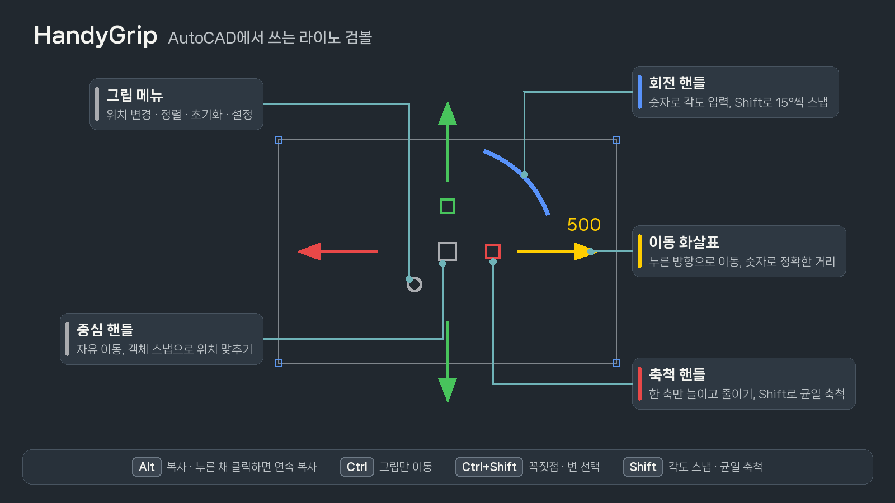
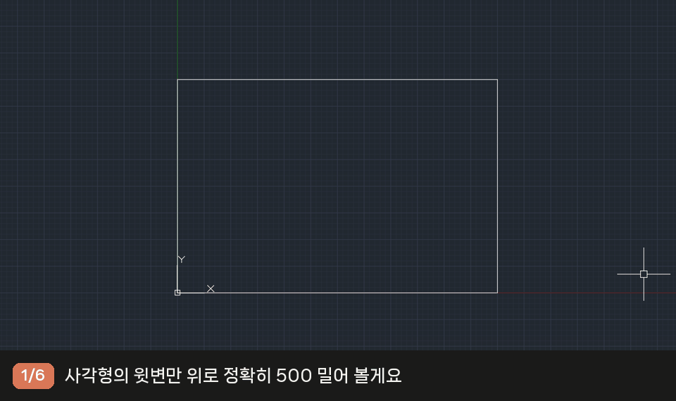
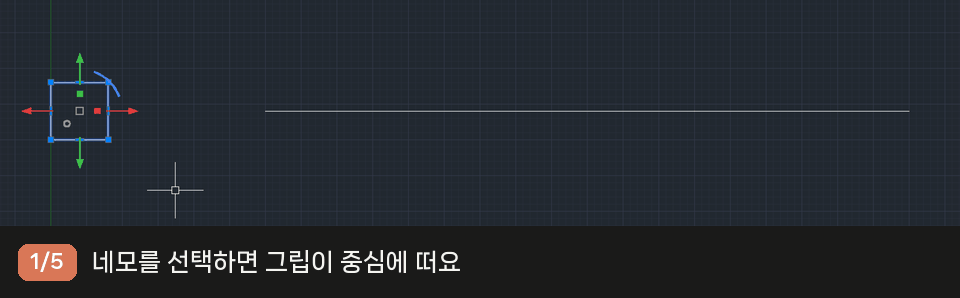
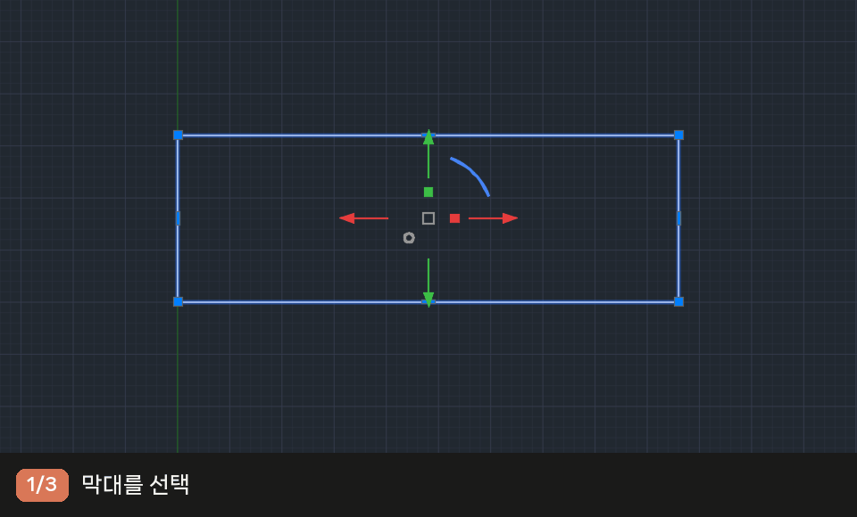
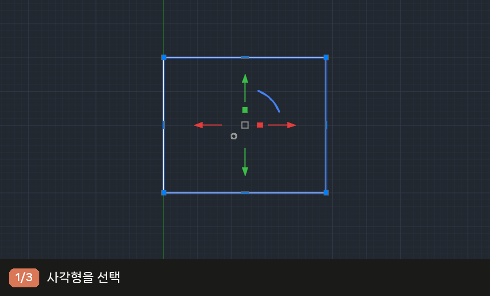
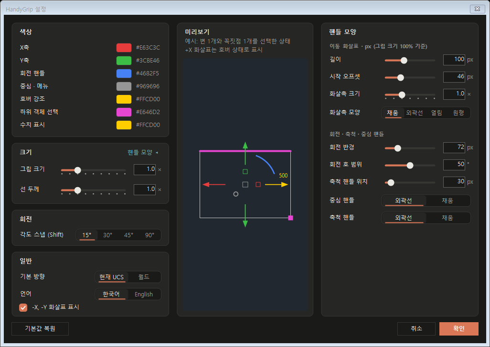

# HandyGrip — Rhino-style Gumball for AutoCAD

**[English README](README.md)**

**AutoCAD에서 쓰는 라이노 검볼(Gumball).** 학교와 작업에서는 Rhino로 그리다가, 납품하고 도면을 정리할 때는 AutoCAD로 넘어가는 일이 많습니다. HandyGrip은 그때도 손에 익은 검볼 방식 그대로 이동·회전·축척할 수 있게 해 주는 작은 플러그인입니다.

**A Rhino-style gumball for AutoCAD.** Select objects and drag on-screen handles to move, rotate and scale them along exact axes, type exact values, snap to points, and Alt-drag to copy, just like the Gumball in Rhino.

키워드: AutoCAD gumball, Rhino gumball for AutoCAD, 오토캐드 검볼, AutoCAD 2D gizmo, move rotate scale handles

> **지원 버전: AutoCAD 2025 이상 (.NET 8).** 2024 이하(.NET Framework 4.8)에서는 로드되지 않습니다.

> HandyGrip은 Robert McNeel & Associates와 관계없는 독립 프로젝트입니다. Rhino, Rhinoceros는 Robert McNeel & Associates의 상표이며, "Gumball"은 Rhino의 기능 이름으로 동작 방식을 설명하기 위해서만 씁니다.
> HandyGrip is an independent project and is not affiliated with or endorsed by Robert McNeel & Associates. Rhino and Rhinoceros are trademarks of Robert McNeel & Associates; "Gumball" refers to the Rhino feature this tool is modeled after.

## 주요 기능

| 기능 | 내용 |
| --- | --- |
| 축 방향 이동 | +X, -X, +Y, -Y 네 방향 화살표. 누른 방향으로 이동하므로 음수를 입력할 일이 없음 |
| 정확한 값 입력 | 움직이는 도중 숫자 키를 누르면 핸들 옆에 입력 칸이 뜸 (거리 · 각도 · 배율) |
| 회전 | 회전 핸들로 회전. Shift를 누르고 있으면 15° 단위 스냅 (단위 변경 가능) |
| 1D 축척 | 한 축만 늘리기. Shift는 균일 축척. 선·폴리선·원·호·타원 지원 |
| 복사 | Alt로 복사 켜기/끄기. Alt를 누른 채 클릭하면 끝점마다 연속 복사 |
| 꼭짓점·변 편집 | Ctrl+Shift 클릭으로 꼭짓점·변만 선택해 정확한 방향과 거리로 이동 |
| 객체 스냅 | AutoCAD 객체 스냅과 연동. 스냅이 잡히면 그립 원점이 그 점에 맞춰짐 |
| 그립 위치 | 기본은 객체 중심(블록은 삽입점). Ctrl 끌기·메뉴로 위치와 방향 변경 |
| 켜기/끄기 | 상태 표시줄의 `HandyGrip ●` 버튼 또는 `HGRIP` 명령. 마지막 상태 기억 |
| 설정 | 색상, 크기, 선 두께, 핸들 모양, 각도 스냅, 기본 방향, 언어(한국어/English) |

## 내려받기와 설치

1. [Releases](https://github.com/Jaem-Shin/handygrip-gumball-for-autocad/releases)에서 **HandyGrip-x.y.z.zip**을 내려받습니다.
2. AutoCAD를 닫고 압축을 푼 뒤, **HandyGrip.bundle** 폴더를 `%AppData%\Autodesk\ApplicationPlugins`에 넣습니다.
3. AutoCAD를 켜면 상태 표시줄에 **HandyGrip ●**이 생깁니다. 객체를 선택하면 그립이 나타납니다.

처음 불러올 때 "서명되지 않은 파일" 경고가 뜨면 **로드** 또는 **항상 로드**를 누르세요. 제거는 `HandyGrip.bundle` 폴더를 지우면 됩니다.

## 사용법

### 핸들

| 핸들 | 동작 |
| --- | --- |
| 이동 화살표 (빨강 좌·우, 초록 위·아래) | 누른 방향으로 이동 |
| 중심 핸들 (가운데 네모) | 자유 이동 |
| 회전 핸들 (파란 호) | 그립 원점을 중심으로 회전 |
| 축척 핸들 (화살표 안쪽 작은 네모) | X 또는 Y 한 축만 축척 |
| 그립 메뉴 (왼쪽 아래 작은 원) | 위치 변경 · 정렬 · 초기화 · 설정 · 끄기 |

- **누른 채 끌기:** 놓는 순간 확정됩니다.
- **클릭:** 객체가 마우스를 따라오고, 한 번 더 클릭하면 확정됩니다.
- **숫자 입력:** 움직이는 도중 숫자 키를 누르면 핸들 옆에 입력 칸이 뜹니다. Enter 적용, Esc 취소. 빠르게 친 키(`500` Enter)도 빠짐없이 들어갑니다.
- 숫자는 누른 화살표 방향으로 적용됩니다. 회전은 시계 방향이 +, 중심 핸들은 커서 방향으로 그 거리만큼 이동합니다.
- 작업이 끝나도 선택이 유지되어 이동 → 회전 → 축척을 이어서 할 수 있습니다.

### 보조 키

| 키 | 동작 |
| --- | --- |
| Alt를 누른 채 핸들 클릭 | 복사로 시작. 계속 누르고 있으면 클릭할 때마다 사본이 찍힘 (끝점 스냅으로 연속 복사). 떼면 끝 |
| Alt (조작 중) | 복사 켜기/끄기. 커서 옆에 `+` 표시 |
| Shift (회전 중) | 각도 스냅 (기본 15°) |
| Shift (축척 핸들을 누르며 시작) | 균일 축척 (`XY ×1.5`) |
| Ctrl (핸들을 누르며 시작) | 객체는 두고 그립만 이동·회전 |
| Ctrl+Shift 클릭 | 꼭짓점·변 선택 (아래 참고) |

- 한 번의 연속 복사는 Ctrl+Z 한 번에 모두 취소됩니다.
- Alt는 커서가 그립 근처에 있거나 그립을 조작하는 동안에만 플러그인이 받습니다. 그 외에는 원래대로 리본 키팁으로 동작합니다.

### 꼭짓점·변 선택 (Ctrl+Shift 클릭)

객체 전체가 아니라 **꼭짓점이나 변만** 옮길 수 있습니다. Rhino의 하위 객체 선택과 같은 방식입니다.

| 동작 | 결과 |
| --- | --- |
| Ctrl+Shift + 꼭짓점 클릭 | 그 점이 선택되고 그립이 그 점에 뜸 |
| Ctrl+Shift + 변 클릭 | 그 변이 선택됨. 변 하나면 그립 X축이 변 방향을 따라 위·아래 화살표가 변을 수직으로 밀고 당김 |
| 계속 Ctrl+Shift 클릭 | 다른 객체여도 추가. 다시 누르면 빠짐 |
| Esc 또는 일반 선택 | 모두 해제 |

- 선택된 꼭짓점·변은 강조색(기본 분홍)으로 표시되고, 그립은 그 가운데에 뜹니다.
- 두 변이 꼭짓점을 공유하면 그 점은 한 번만 움직입니다. 복사(Alt)는 지원하지 않습니다.
- 지원 객체: 선(LINE), 폴리선(LWPOLYLINE). 폴리선 호 구간은 곡률을 유지한 채 끝점만 움직입니다.

### 그립 위치

| 상황 | 그립 위치 | 바뀌는 때 |
| --- | --- | --- |
| 기본 | 객체 중심. 블록 하나는 삽입점과 블록 방향 | 다른 명령으로 객체를 바꾸면 새 중심을 따라감 |
| 그립으로 이동·회전한 뒤 | 옮긴·돌린 자리 | 선택 해제, 다른 명령으로 객체 수정 |
| 직접 정한 위치 (Ctrl 끌기, 위치 변경, 정렬) | 정한 자리. 객체 하나면 도면에 저장되어 다시 선택해도 유지. 꼭짓점에 맞췄으면 그 꼭짓점을 따라감 | `HGRIPRESET` |

## 사용 예시

**1. 사각형 한 변만 정확히 500 밀기** — Ctrl+Shift로 윗변 선택 → 위쪽 화살표 클릭 → `500` Enter

**2. 끝점마다 연속 복사** — Alt를 누른 채 중심 핸들 클릭 → 끝점들을 차례로 클릭 → Alt를 떼면 끝

**3. 15° 단위 회전** — 회전 핸들 클릭 → Shift를 누른 채 돌리기 → 클릭

**4. 가로만 2배** — X 축척 핸들 클릭 → `2` Enter

## 설정

그립 메뉴의 "설정..." 또는 `HGRIPSETTINGS` 명령. 오른쪽 미리보기에 바로 반영되며, "핸들 모양 ▸"을 누르면 세부 칸이 펼쳐집니다.

| 칸 | 항목 |
| --- | --- |
| 색상 | X축, Y축, 회전 핸들, 중심·메뉴, 호버 강조, 하위 객체 선택, 수치 표시 |
| 크기 | 그립 크기, 선 두께 (×0.5~×2.5, 0.25 단위 스냅, 직접 입력 0.25~4.0) |
| 회전 | 각도 스냅 (Shift): 15° / 30° / 45° / 90° |
| 일반 | 기본 방향 (현재 UCS / 월드), 언어 (한국어 / English), -X·-Y 화살표 표시 |
| 핸들 모양 | 화살표 길이, 시작 오프셋, 화살촉 크기·모양(채움/외곽선/열림/원형), 회전 반경, 회전 호 범위(10°~90°), 축척 핸들 위치, 중심·축척 핸들(외곽선/채움) |

설정은 `%AppData%\HandyGrip\settings.json`에 저장됩니다.

## 명령

| 명령 | 설명 |
| --- | --- |
| `HGRIP` | 켜기/끄기 (상태 표시줄 버튼과 같음) |
| `HGRIPSETTINGS` | 설정 창 |
| `HGRIPRELOCATE` | 그립 위치 변경 |
| `HGRIPALIGN` | 그립 정렬 [Ucs/World/Object] |
| `HGRIPRESET` | 그립 위치 초기화 |
| `HGRIPDEBUG` | 스냅 진단 (문제 확인용) |

## 제한 사항

- 평면도(위에서 본 뷰) 기준입니다. 3D로 기울어진 뷰에서는 핸들 판정이 어긋날 수 있습니다.
- 1D 축척: 원·호·타원은 타원으로 변환, 폴리선 호 구간의 곡률은 근사값, 문자와 축이 맞지 않는 블록은 건너뜁니다.
- 잠긴 도면층의 객체는 건너뜁니다.
- 선택한 객체가 400개를 넘으면 미리보기를 경계 상자로 대신 그립니다.

## 라이선스

개인·회사·교육 목적 모두 무료로 쓸 수 있습니다. 수정·재배포·역분석은 허용하지 않습니다. 자세한 내용은 [LICENSE.txt](LICENSE.txt)를 보세요. 소스 코드는 공개하지 않습니다.

문의와 버그 제보: [Issues](https://github.com/Jaem-Shin/handygrip-gumball-for-autocad/issues)
