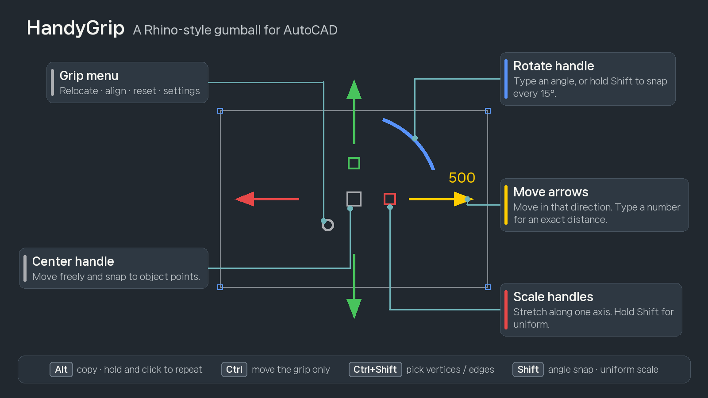
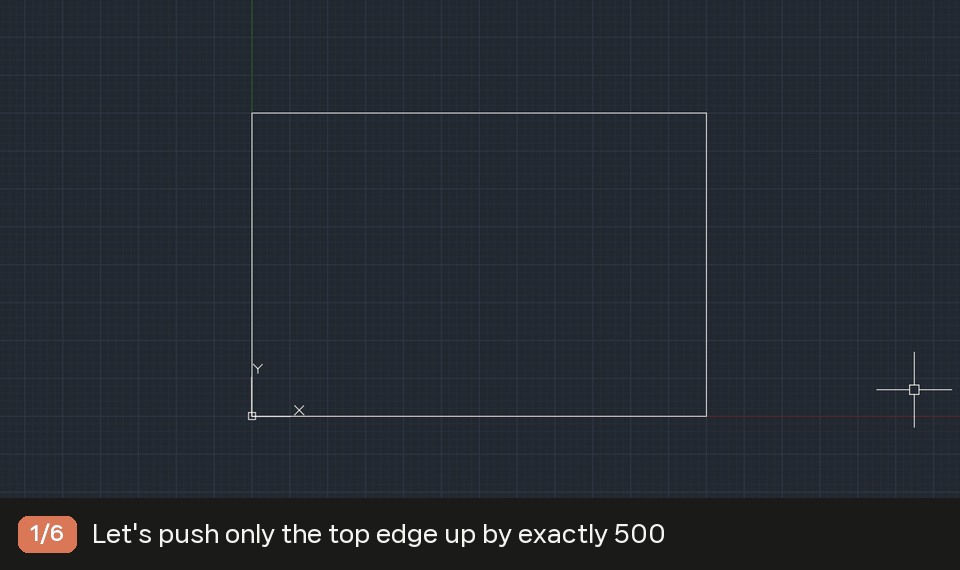
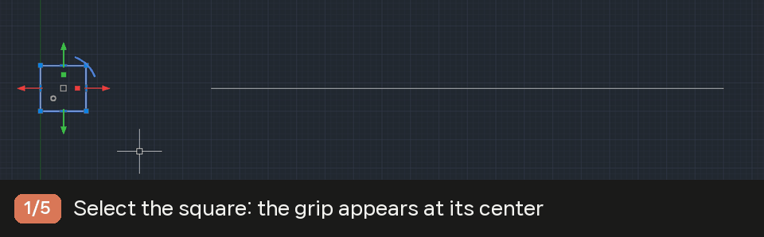
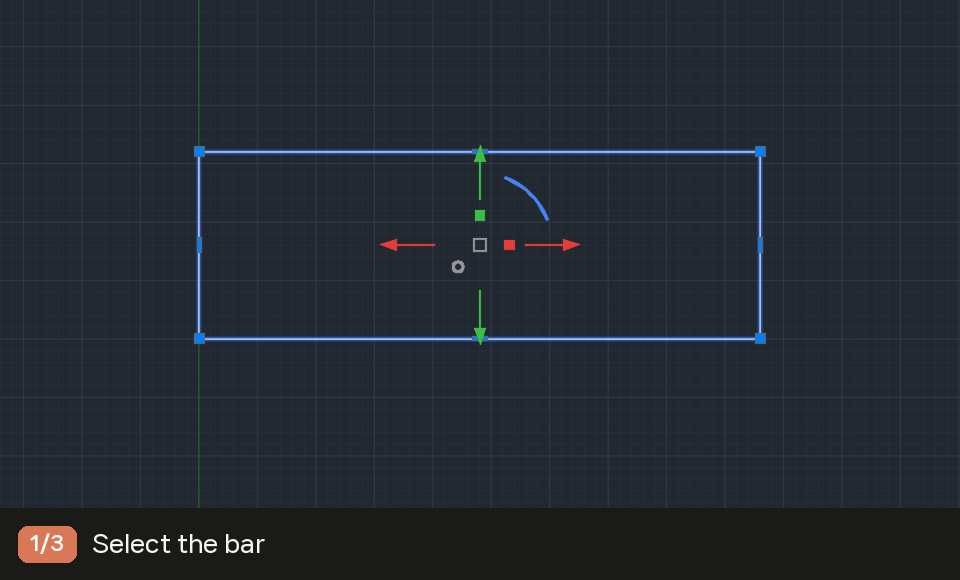
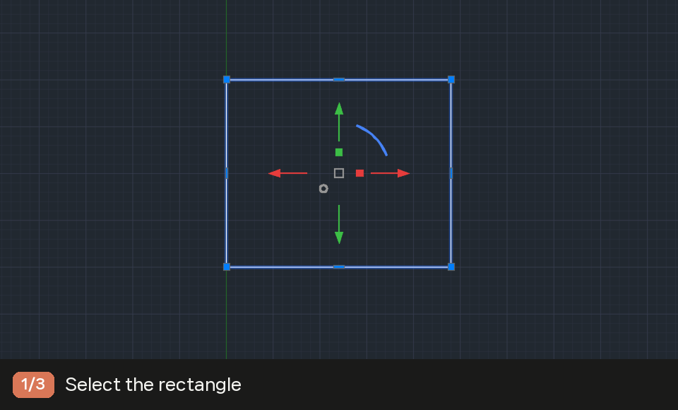
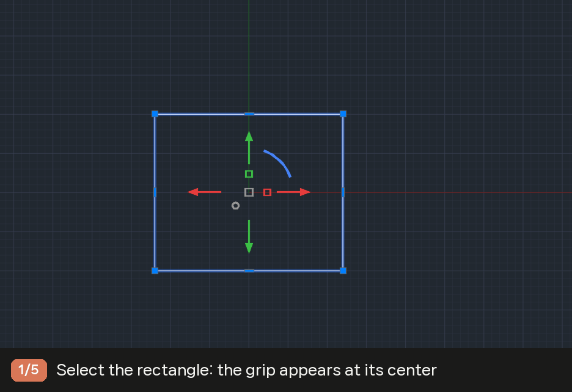
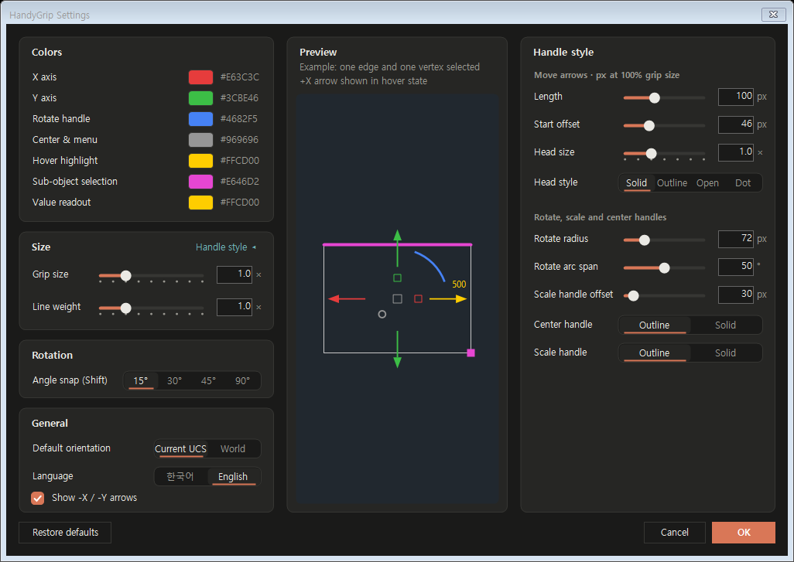

# HandyGrip — Rhino-style Gumball for AutoCAD

**[한국어 README](README.ko.md)**

**Use Rhino's gumball in AutoCAD.** Many of us model in Rhino at school or in the studio, then have to finish, deliver and present drawings in AutoCAD. HandyGrip is a small plugin that lets you keep the gumball workflow you already know: select objects, then drag on-screen handles to move, rotate and scale them along exact axes, type exact values, snap to points and Alt-copy.

Keywords: AutoCAD gumball, AutoCAD 2021 2022 2023 2024 2025 2026, Rhino gumball for AutoCAD, 오토캐드 검볼, AutoCAD 2D gizmo, move rotate scale handles, AutoCAD plugin

> **Works with AutoCAD 2021 – 2026 (64-bit Windows).** One installer covers every version: AutoCAD loads the right build by itself.
> **AutoCAD LT is not supported.** See [Supported versions](#supported-versions).

> HandyGrip is an independent project and is not affiliated with or endorsed by Robert McNeel & Associates. Rhino and Rhinoceros are trademarks of Robert McNeel & Associates; "Gumball" refers to the Rhino feature this tool is modeled after. AutoCAD is a trademark of Autodesk, Inc.

## Supported versions

| AutoCAD | Supported |
| --- | --- |
| AutoCAD 2025, 2026 | Yes |
| AutoCAD 2021, 2022, 2023, 2024 | Yes |
| AutoCAD 2020 and earlier | No |
| AutoCAD LT (any version) | No |
| AutoCAD for Mac, AutoCAD Web | No |

Vertical products built on AutoCAD (Architecture, Mechanical, MEP, Civil 3D and so on) of the same years should also work, but are not tested.

**Why not AutoCAD LT?** HandyGrip is a .NET plugin. AutoCAD LT does not load .NET plugins at all (only full AutoCAD does), so it cannot run in LT even after installing. This is a limit of LT itself, not something a future HandyGrip update can change.

## Download and install

**Installer (recommended)**

1. Download **HandyGrip-x.y.z-Setup.exe** from [Releases](https://github.com/Jaem-Shin/handygrip-gumball-for-autocad/releases) and run it.
2. Pick English or 한국어 on the first screen. HandyGrip starts in that language.
3. Start AutoCAD. When the status bar shows **HandyGrip ●**, you are ready. Select objects to show the grip.

It installs for the current user only and needs no administrator rights. The installer is unsigned, so if Windows shows "Windows protected your PC", click **More info → Run anyway**. To uninstall, go to **Settings → Apps → Installed apps → HandyGrip (AutoCAD)**. Your settings are kept for the next install.

**Manual install from the zip**

1. Download **HandyGrip-x.y.z.zip**.
2. Close AutoCAD, unzip, and copy the **HandyGrip.bundle** folder into `%AppData%\Autodesk\ApplicationPlugins`. To uninstall, delete that folder.

Either way, if AutoCAD warns that the file is unsigned the first time, choose **Load** or **Always Load**. You can change the language later in `HGRIPSETTINGS` → General → Language.

## Features

| Feature | What it does |
| --- | --- |
| Axis move | Four arrows (+X, -X, +Y, -Y). Typed distances follow the arrow you pressed, so no negative numbers |
| Exact values | Start typing while moving and a number box appears next to the handle (distance, angle, factor) |
| Rotate | Rotate handle. Hold Shift to snap every 15° (30°, 45°, 90° also available) |
| 1D scale | Stretch one axis. Shift for uniform. Lines, polylines, circles, arcs and ellipses |
| Copy | Alt toggles copy. Hold Alt and keep clicking to drop a copy on every snapped point |
| Vertices and edges | Ctrl+Shift click picks vertices or edges, then move them by exact directions and values |
| Object snap | Works with AutoCAD OSNAP. When a snap is found, the grip origin lands on that point |
| Grip position | Object center by default (insertion point for blocks). Ctrl-drag or the grip menu to relocate or align |
| On/off | **HandyGrip ●** on the status bar or `HGRIP`. Remembers the last state |
| Settings | Colors, size, line weight, handle style, angle snap, default orientation, language (한국어/English) |

## Examples

**1. Push one edge by exactly 500**: Ctrl+Shift click the top edge → click the up arrow → `500` Enter

**2. Copy onto every endpoint**: hold Alt and click the center handle → click the endpoints → release Alt

**3. Rotate in 15° steps**: click the rotate handle → hold Shift while turning → click

**4. Double the width only**: click the X scale handle → `2` Enter

**5. Move the grip to a corner and rotate around it**: Ctrl+click the center handle → click the corner → click the rotate handle → `30` Enter

## Handles and keys

| Handle | Action |
| --- | --- |
| Move arrows (red: left/right, green: up/down) | Move in that direction |
| Center handle | Free move |
| Rotate handle (blue arc) | Rotate about the grip origin |
| Scale handles (small squares on the axes) | Scale along X or Y |
| Grip menu (small circle, lower left) | Relocate · align · reset · settings · turn off |

| Key | Action |
| --- | --- |
| Alt + click a handle | Start as a copy. Keep holding Alt to keep copying with each click |
| Alt (while moving) | Toggle copy (a `+` appears by the cursor) |
| Shift (while rotating) | Angle snap |
| Shift + click a scale handle | Uniform scale |
| Ctrl + click a handle | Move or rotate the grip only, not the objects |
| Ctrl+Shift + click | Pick vertices or edges (lines and polylines) |

Click a handle to have the objects follow the mouse, then click again to finish, or press and drag and release. One repeated Alt copy is undone with a single Ctrl+Z.

## Settings

Open from the grip menu → Settings, or with `HGRIPSETTINGS`. The preview updates as you change values; **Handle style ▸** expands the detailed options.

## Commands

| Command | Description |
| --- | --- |
| `HGRIP` | Turn on/off (same as the status bar button) |
| `HGRIPSETTINGS` | Settings window |
| `HGRIPRELOCATE` | Relocate the grip |
| `HGRIPALIGN` | Align the grip [Ucs/World/Object] |
| `HGRIPRESET` | Reset the grip position |

## Limitations

- Designed for plan views. Handle picking can be off in tilted 3D views.
- 1D scale: circles, arcs and ellipses become ellipses; polyline arc bulges are approximated; text and blocks that do not line up with the axis are skipped.
- Objects on locked layers are skipped.
- With more than 400 selected objects, the drag preview shows a bounding box instead.

## License

Free to use for personal, commercial and educational work. Modification, redistribution and reverse engineering are not permitted. See [LICENSE.txt](LICENSE.txt). The source code is not public.

Questions and bug reports: [Issues](https://github.com/Jaem-Shin/handygrip-gumball-for-autocad/issues).
